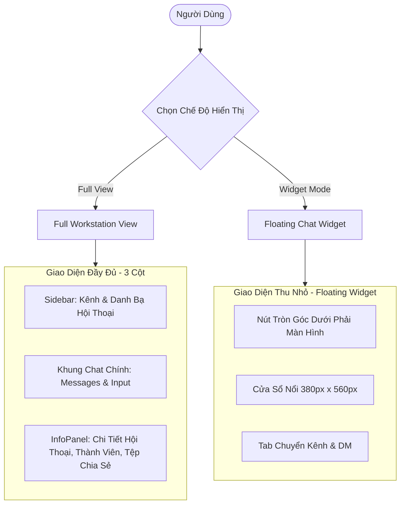

# Hướng Dẫn Thiết Kế Giao Diện & Trải Nghiệm (UI/UX Design Guidelines)

Tài liệu này quy chuẩn hệ thống thiết kế (Design System), bảng màu (Color Tokens), các mẫu giao diện (UI Patterns) và trải nghiệm người dùng (UX) áp dụng trên toàn bộ các ứng dụng Web, Mobile và Desktop của **Enterprise Chat App**.

---

## 1. Triết Lý Thiết Kế (Design Philosophy)

- **Trực quan & Tinh gọn (Clutter-Free & Intuitive)**: Tối ưu không gian hiển thị cho nội dung trò chuyện, giảm thiểu các yếu tố gây xao nhãng trong môi trường làm việc doanh nghiệp.
- **Tốc độ & Phản hồi tức thì (Instant Feedback)**: Mọi thao tác gửi tin nhắn, thả cảm xúc, nhận cuộc gọi đều có phản hồi hình ảnh và âm thanh ngay lập tức (Optimistic UI updates).
- **Nhất quán đa nền tảng (Cross-Platform Consistency)**: Biểu tượng (Lucide Icons), trạng thái hiện diện và cấu trúc hội thoại đồng nhất giữa Web, Mobile (Expo) và Desktop (Electron).

---

## 2. Hệ Thống Màu Sắc & 5 Chủ Đề Doanh Nghiệp (Themes & Color System)

Ứng dụng hỗ trợ chuyển đổi linh hoạt giữa 5 bộ chủ đề chuyên nghiệp:

| Tên Chủ Đề | Mã Theme | Màu Nền Chính (`bg`) | Màu Điểm Nhấn (`primary`) | Mục Đích Sử Dụng |
|------------|----------|----------------------|---------------------------|-------------------|
| **Default Dark** | `default` | `#09090b` (Zinc 950) | `#6366f1` (Indigo 500) | Giao diện tối hiện đại, bảo vệ mắt khi làm việc ban đêm. |
| **Slate Corporate** | `slate` | `#0f172a` (Slate 900) | `#0ea5e9` (Sky 500) | Phong cách chuẩn văn phòng công nghệ cao, thanh lịch. |
| **Midnight Navy** | `midnight` | `#030712` (Gray 950) | `#2563eb` (Blue 600) | Tối giản, tập trung cao độ, phong cách tài chính/ngân hàng. |
| **Emerald Forest** | `emerald` | `#052e16` / `#09090b` | `#10b981` (Emerald 500) | Tông màu xanh lá dịu mắt, năng lượng tích cực. |
| **Rose Minimal** | `rose` | `#18181b` (Zinc 900) | `#f43f5e` (Rose 500) | Tinh tế, sáng tạo, phù hợp khối thiết kế và truyền thông. |

### 2.1. Trạng Thái Hiện Diện (Presence Indicators)
- **ONLINE**: Xanh lá cây (`#22c55e` - Green 500) kèm viền nền.
- **AWAY**: Vàng cam (`#eab308` - Yellow 500).
- **BUSY / DND**: Đỏ tươi (`#ef4444` - Red 500).
- **OFFLINE**: Xám trung tính (`#6b7280` - Gray 500).

---

## 3. Kiến Trúc Hiển Thị Kép (Dual-View Architecture)

Ứng dụng Web hỗ trợ 2 chế độ hiển thị linh hoạt được điều khiển bởi trạng thái `viewMode` trong `useChatStore`:

### 3.1. Chế Độ Toàn Màn Hình (Full Workstation View)
- Bố cục 3 cột kinh điển:
  - **Cột trái (Sidebar 280px)**: Tìm kiếm hội thoại, danh sách Kênh công ty, Kênh phòng ban, Danh bạ DM trực tiếp, thông tin User cá nhân.
  - **Cột giữa (Chat Area - Flex 1)**: Thanh tiêu đề kênh (tên, mô tả, số thành viên, nút tìm kiếm, nút gọi), thanh ghim PinnedMessageBar, danh sách tin nhắn cuộn mượt (MessageList) và khung soạn thảo MessageInput.
  - **Cột phải (InfoPanel 320px - Tùy chọn đóng/mở)**: Xem chi tiết phòng ban, danh sách thành viên trực tuyến, kho lưu trữ đa phương tiện (ảnh, tệp đã gửi trong phòng).

### 3.2. Chế Độ Tiện Ích Nổi (Floating Chat Widget)
- Nút tròn kích hoạt cố định ở góc dưới cùng bên phải màn hình (`bottom-6 right-6`), hiển thị huy hiệu (badge) tin nhắn chưa đọc màu đỏ.
- Khi mở, hiển thị cửa sổ popup kích thước chuẩn `380px x 560px` có bóng mờ (box-shadow) lớn và góc bo `rounded-2xl`.
- Hỗ trợ đầy đủ việc chuyển đổi giữa danh sách chat thu nhỏ và xem chi tiết cuộc trò chuyện mà không chiếm toàn bộ màn hình làm việc.

---

## 4. Quy Chuẩn Thành Phần Giao Diện (Component Guidelines)

### 4.1. Bong Bóng Tin Nhắn (Message Bubbles)
- **Tin nhắn gửi đi (Sent by current user)**:
  - Căn lề phải (`justify-end`).
  - Màu nền: Primary Color (`bg-indigo-600` hoặc theo theme active), chữ trắng.
  - Hiển thị dấu tích trạng thái: Đang gửi (`Clock`), Đã gửi (`Check`), Đã xem (`CheckCheck` màu xanh dương).
- **Tin nhắn nhận về (Received)**:
  - Căn lề trái (`justify-start`).
  - Hiển thị Avatar tác giả bên cạnh tin nhắn đầu tiên của khối liên tục.
  - Màu nền: Thẻ tối trung tính (`bg-zinc-800/80` hoặc `bg-slate-800`), chữ xám nhạt (`text-zinc-100`).
- **Thanh thao tác tin nhắn (Hover Action Bar)**:
  - Hiển thị khi hover chuột trên Web hoặc ấn giữ (long-press) trên Mobile.
  - Các nút thao tác: Thả cảm xúc emoji, Trả lời (Reply), Ghim (Pin), Chuyển tiếp (Forward), Đánh dấu sao (Star), Sửa/Thu hồi (chỉ áp dụng cho tin nhắn của chính mình).

### 4.2. Khảo Sát & Bình Chọn (Poll Component)
- Tiêu đề câu hỏi in đậm kèm nhãn "Khảo sát nội bộ".
- Các tùy chọn hiển thị dạng thanh tiến trình (Progress Bar) với tỷ lệ phần trăm số phiếu bầu trực quan.
- Tự động đánh dấu tùy chọn người dùng hiện tại đã bỏ phiếu và cho phép hủy hoặc đổi lựa chọn nếu người tạo cho phép.

### 4.3. Tin Nhắn Thoại (Voice Message Player)
- Nút Play/Pause tròn, hiển thị thời lượng ghi âm (ví dụ: `0:42`).
- Dải sóng âm thanh trực quan (Waveform) mô phỏng nhịp điệu giọng nói, có thanh trượt tiến độ tương tác khi đang phát.

### 4.4. Cuộc Gọi Nội Bộ (Call Modal)
- Cửa sổ thoại/video nổi bật với hiệu ứng làm mờ nền (Backdrop Blur).
- Trạng thái cuộc gọi rõ ràng: "Đang đổ chuông...", "Đang kết nối...", "Thời gian gọi: 03:25".
- Các phím chức năng lớn: Bật/Tắt Microphone (`Mic`/`MicOff`), Bật/Tắt Camera (`Video`/`VideoOff`), Nút Kết Thúc Cuộc Gọi màu đỏ nổi bật (`PhoneOff`).

---

## 5. Âm Thanh & Phản Hồi Xúc Giác (Sound & Haptics)

Hệ thống tích hợp dịch vụ âm thanh `soundService.ts` sử dụng trực tiếp **Web Audio API** mà không cần tải các tệp tin mp3 dung lượng lớn:
- **Âm thanh gửi tin nhắn (Send Tone)**: Hai âm tần cao nhẹ nhàng (`800Hz` -> `1200Hz`) trong 80ms, mang lại cảm giác phản hồi nhanh.
- **Âm thanh nhận tin nhắn (Receive Tone)**: Hợp âm vui tươi (`587Hz` -> `880Hz`) trong 150ms khi có tin nhắn mới trong phòng.
- **Chuông cuộc gọi đến (Incoming Ringtone)**: Vòng lặp âm rung chuông điện thoại cổ điển (`440Hz` + `480Hz`) có nhịp ngắt quãng 2 giây.

Trên ứng dụng di động (Mobile React Native), mọi thao tác gửi tin, thả cảm xúc và nhận thông báo đều đi kèm rung phản hồi (Haptic Feedback) phù hợp.

---

## 6. Khả Năng Tiếp Cận & Khả Năng Thích Ứng (Accessibility & Responsiveness)

- **Target Size trên Mobile**: Tất cả các nút bấm, icon cảm ứng có kích thước tối thiểu `44px x 44px` để tránh bấm nhầm.
- **Tương phản màu sắc (Contrast Ratio)**: Mọi đoạn văn bản hiển thị trên nền tối đều đạt chuẩn tối thiểu **WCAG AA** (tỷ lệ tương phản >= 4.5:1).
- **Hỗ trợ Safe Area**: Ứng dụng Mobile tự động chừa khoảng cách an toàn cho thanh trạng thái (Status Bar) và dải điều hướng dưới cùng (Home Indicator trên iOS và Navigation Bar trên Android).
