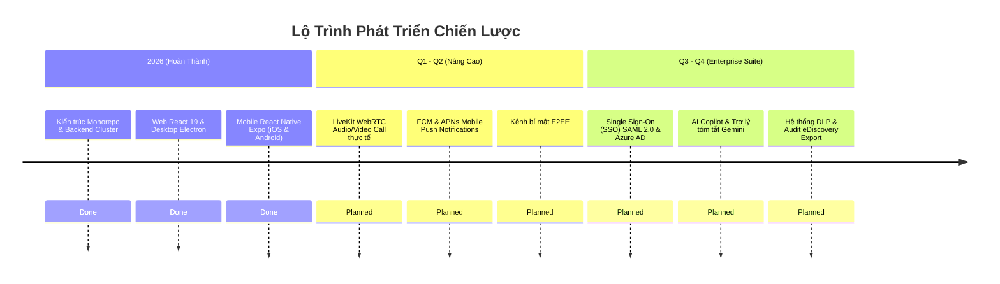

# Lộ Trình Phát Triển Dự Án (Project Roadmap)

Tài liệu này ghi nhận các mốc phát triển đã hoàn thành (Completed Milestones), hiện trạng hệ thống và kế hoạch chiến lược phát triển mở rộng trong tương lai của dự án **Enterprise Chat App**.

---

## 1. Hiện Trạng Hệ Thống (Current Status Summary)

Hệ thống đã hoàn tất quá trình thiết lập kiến trúc cơ bản, di chuyển toàn diện sang kiến trúc Monorepo thống nhất, sở hữu trọn vẹn 4 ứng dụng khách và máy chủ:
- **Hạ tầng Dữ liệu & Máy chủ (`apps/server`)**: Đã hoàn thành và ổn định với NestJS 10, PostgreSQL 16 (Prisma), Redis 7 và MinIO S3.
- **Thư viện Dùng Chung (`packages/shared-types`)**: Đã chuẩn hóa toàn bộ Enums, DTOs, Socket Events và Interfaces.
- **Ứng Dụng Web (`apps/web`)**: Đã hoàn thành với Next.js 15, React 19, Tailwind CSS, hỗ trợ chế độ kép (Full Workstation & Floating Widget), 5 theme màu và đầy đủ 17 tính năng cốt lõi.
- **Ứng Dụng Di Động (`apps/mobile`)**: Đã hoàn thành phiên bản React Native (Expo SDK 52) hỗ trợ cả iOS và Android.
- **Ứng Dụng Máy Tính (`apps/desktop`)**: Đã hoàn thành bản đóng gói Electron 33+ tích hợp System Tray và thông báo hệ điều hành.

---

## 2. Các Giai Đoạn Đã Hoàn Thành (Completed Milestones)

| Giai Đoạn | Tên Giai Đoạn | Mục Tiêu & Kết Quả Đạt Được | Trạng Thái |
|-----------|---------------|-----------------------------|:----------:|
| **Phase 1** | **Khởi Tạo Kiến Trúc & Hạ Tầng** | Thiết lập cấu trúc Monorepo `pnpm workspace`, cấu hình TypeScript base, khởi tạo `docker-compose.yml` (Postgres, Redis, MinIO), thiết kế schema Prisma và seed dữ liệu mẫu 4 phòng ban và 4 tài khoản mặc định. | ✅ Hoàn thành |
| **Phase 2** | **Nhắn Tin Thời Gian Thực & Kênh** | Xây dựng Socket.io Gateway tích hợp `@socket.io/redis-adapter` hỗ trợ mở rộng ngang đa node, xử lý tin nhắn text, tệp đính kèm, tin nhắn thoại, bình chọn (Polls), reactions emoji và xử lý chống trùng lặp `directKey` cho hội thoại 1-1. | ✅ Hoàn thành |
| **Phase 3** | **Lưu Trữ Tệp S3 & Phân Quyền RBAC** | Xây dựng dịch vụ FilesService sinh Presigned PUT/GET URL an toàn, kiểm soát kích thước tệp và quyền sở hữu attachment, thiết lập hệ thống bảo vệ Anti-BOLA trong WebSocket và ma trận phân quyền 5 cấp bậc (`UserRole`). | ✅ Hoàn thành |
| **Phase 4** | **Phát Triển Web React & Electron Desktop** | Xây dựng giao diện Next.js 15 hiện đại, kho quản lý trạng thái Zustand `useChatStore`, chuyển đổi chế độ Dual-View, tích hợp âm thanh Web Audio API `soundService.ts` và đóng gói Electron Desktop client. | ✅ Hoàn thành |
| **Phase 5** | **Di Chuyển & Chuẩn Hóa Mobile App** | Xây dựng ứng dụng di động React Native trên nền Expo SDK 52 và Expo Router tại `apps/mobile`, gỡ bỏ hoàn toàn mọi tàn dư thương hiệu cũ, kết nối mượt mà tới REST API và WebSocket Gateway. | ✅ Hoàn thành |

---

## 3. Lộ Trình Phát Triển Ngắn Hạn (Short-Term: Q1 - Q2)

Tập trung nâng cao chất lượng trải nghiệm trực tiếp của người dùng trên nền tảng sẵn có:

### 3.1. Nâng Cấp Hệ Thống Thoại & Video Trực Tiếp (Real WebRTC Media Server)
- *Hiện tại*: Cuộc gọi đang được mô phỏng tín hiệu chuông và trạng thái kết nối thông qua WebSocket signalling.
- *Mục tiêu*: Tích hợp Media Server chuyên dụng (LiveKit hoặc Mediasoup) để truyền dẫn luồng âm thanh và hình ảnh thực tế chất lượng cao, độ trễ thấp (<200ms) giữa 2 nhân viên (1-1 Call) và hội nghị nhóm nhỏ (Group Audio Room).

### 3.2. Hạ Tầng Thông Báo Đẩy Cho Thiết Bị Di Động (Mobile Push Notifications)
- Tích hợp dịch vụ Expo Push Notification Service kết hợp Firebase Cloud Messaging (FCM cho Android) và Apple Push Notification service (APNs cho iOS).
- Người dùng nhận thông báo tin nhắn mới và cuộc gọi đến ngay cả khi ứng dụng đang chạy nền hoặc bị đóng hoàn toàn.

### 3.3. Chế Độ Kênh Bí Mật Mã Hóa Đầu Cuối (Optional E2EE Secret Channels)
- Bổ sung tùy chọn tạo kênh bí mật áp dụng thuật toán mã hóa đầu cuối (Signal Protocol / Olm/Megolm).
- Khóa giải mã chỉ lưu cục bộ trên thiết bị của các thành viên trong kênh; máy chủ backend không thể đọc được nội dung tin nhắn.

---

## 4. Lộ Trình Phát Triển Trung Hạn (Mid-Term: Q3 - Q4)

Tập trung vào các tiêu chuẩn tích hợp và tuân thủ dành cho khối khách hàng doanh nghiệp quy mô lớn:

### 4.1. Tích Hợp Đăng Nhập Một Lần (Enterprise SSO & LDAP)
- Hỗ trợ giao thức SAML 2.0 và OpenID Connect (OIDC).
- Tự động đồng bộ người dùng và phòng ban từ Microsoft Entra ID (Azure AD), Okta, Keycloak và Google Workspace.

### 4.2. Trợ Lý Doanh Nghiệp Tích Hợp AI (AI Smart Assistant & Copilot)
- Tích hợp mô hình ngôn ngữ lớn (Gemini 2.5/Flash hoặc LLM tự host như Ollama/Llama 3).
- Tính năng: Gợi ý câu trả lời thông minh (Smart Reply), tìm kiếm ngữ nghĩa theo ngữ cảnh (Semantic Search) trong kho tài liệu tệp tin đính kèm, dịch tự động tin nhắn đa ngôn ngữ.

### 4.3. Phòng Chống Thất Thoát Dữ Liệu & Kiểm Toán Tuân Thủ (DLP & Compliance)
- Cơ chế quét tự động chặn các thông tin nhạy cảm (Số thẻ tín dụng, căn cước công dân, API keys, mật khẩu) trước khi tin nhắn được gửi đi.
- Công cụ dành riêng cho Giám đốc An ninh Thông tin (CISO): Xuất dữ liệu kiểm toán pháp lý (eDiscovery Export) theo khoảng thời gian và đối tượng người dùng cụ thể.

---

## 5. Tiêu Chuẩn Duy Trì Chất Lượng & Cổng Kiểm Soát (Quality Gates)

Mỗi giai đoạn nâng cấp mới bắt buộc phải tuân thủ nghiêm ngặt các cổng kiểm tra chất lượng theo tài liệu `docs/code-standards.md`:
1. `pnpm build` biên dịch thành công 100% trên toàn bộ workspace (`apps/server`, `apps/web`, `apps/mobile`, `packages/shared-types`).
2. Typecheck không có cảnh báo vi phạm `strict: true`.
3. Kiểm thử tải WebSocket và API HTTP bằng kịch bản K6 (`tests/load/websocket-load.js`) đáp ứng tối thiểu 1,000 kết nối đồng thời với thời gian phản hồi p95 < 100ms.
