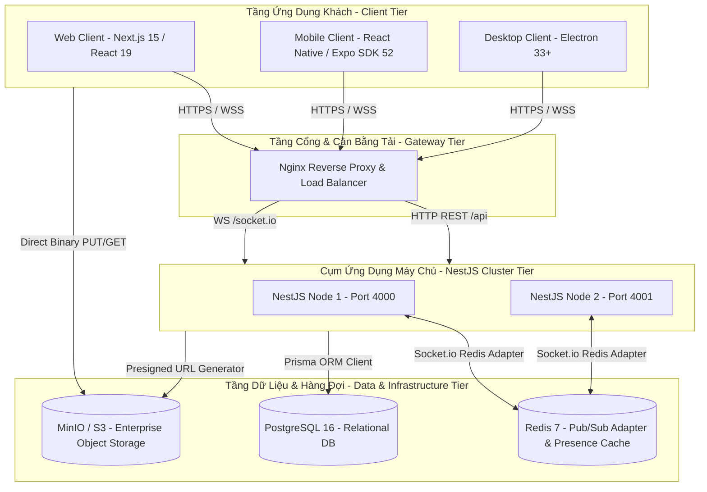
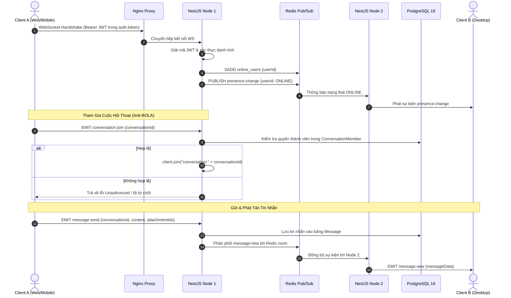

# Kiến Trúc Hệ Thống (System Architecture)

Tài liệu này mô tả chi tiết kiến trúc tổng thể, luồng dữ liệu thời gian thực, quy trình lưu trữ tệp tin an toàn và mô hình bảo mật của hệ thống **Enterprise Chat App**.

---

## 1. Sơ Đồ Kiến Trúc Tổng Thể (System Architecture Diagram)



---

## 2. Luồng Xử Lý Thời Gian Thực (Realtime Pipeline)

Hệ thống sử dụng **Socket.io 4** kết hợp với `@socket.io/redis-adapter` để đảm bảo tin nhắn được phân phối tức thì giữa nhiều node máy chủ NestJS:



### 2.1. Các Bước Xử Lý Cốt Lõi:
1. **Kết Nối & Xác Thực**:
   - Khi client kết nối WebSocket, JWT được gửi trong `auth.token` qua handshake.
   - `ChatGateway.handleConnection` giải mã token, xác minh tài khoản người dùng trong cơ sở dữ liệu.
   - Client được tự động đưa vào room cá nhân `user:{userId}` và trạng thái `ONLINE` được cập nhật vào Redis Set kèm TTL.
2. **Kiểm Soát Quyền Gia Nhập Room (Anti-BOLA)**:
   - Trước khi cho phép một socket tham gia `conversation:{id}`, hệ thống bắt buộc truy vấn bảng `ConversationMember` để đối chiếu quyền hạn. Socket không có quyền sẽ bị từ chối, ngăn chặn rò rỉ dữ liệu giữa các phòng ban.
3. **Phân Phối Tin Nhắn Qua Redis**:
   - Khi tin nhắn được lưu thành công vào PostgreSQL, sự kiện được phát tán qua Redis Adapter tới toàn bộ các node NestJS khác trong cụm để chuyển tiếp tới các client đang theo dõi.

---

## 3. Quy Trình Tải Lên Tệp Tin Trực Tiếp (Direct S3 Presign Flow)

Để tối ưu hóa băng thông, loại bỏ nghẽn cổ chai và không tiêu tốn bộ nhớ RAM của cụm máy chủ API:

```
Client (Web / Mobile / Desktop)      NestJS API (FilesService)             MinIO / S3 Storage
          |                                      |                                 |
          | 1. POST /api/files/presign-upload    |                                 |
          |------------------------------------->|                                 |
          |                                      | 2. Kiểm tra quyền thành viên    |
          |                                      | 3. Sinh UUID & làm sạch tên file|
          |                                      | 4. Sinh S3 PutObject Signed URL |
          |                                      | 5. Lưu record Attachment PENDING|
          | 6. Trả về uploadUrl & attachmentId   |                                 |
          |<-------------------------------------|                                 |
          |                                                                        |
          | 7. PUT file payload trực tiếp tới S3 (HTTP Binary, Header định dạng)  |
          |----------------------------------------------------------------------->|
          | 8. MinIO xác thực chữ ký và lưu trữ tệp tin vào bucket                 |
          |<-----------------------------------------------------------------------|
          |                                                                        |
          | 9. Gửi tin nhắn kèm danh sách attachmentIds qua WebSocket              |
          |------------------------------------->|                                 |
          |                                      | 10. Chuyển trạng thái ATTACHED  |
```

---

## 4. Xử Lý Đồng Thời & Chống Trùng Lặp Hội Thoại 1-1 (Concurrency DirectKey)

Khi 2 người dùng (ví dụ: A và B) cùng lúc mở cửa sổ chat 1-1 với nhau, có thể phát sinh hiện tượng tạo trùng lặp 2 cuộc hội thoại riêng biệt (Race Condition):

```
User A ──┐
         ├──> [POST /channels/direct] ──> Race Condition?
User B ──┘
```

**Giải pháp kỹ thuật của Enterprise Chat App**:
- Hệ thống chuẩn hóa khóa trực tiếp: `directKey = [userIdA, userIdB].sort().join(':')`.
- Cột `directKey` trong bảng `Conversation` được đánh chỉ mục duy nhất (`@unique`).
- Khi xảy ra xung đột đồng thời, Prisma trả về mã lỗi `P2002` (Unique constraint failed). Backend tự động bắt lỗi này và thực hiện truy vấn trả về cuộc hội thoại đã được tạo trước đó, đảm bảo 100% không tạo bản ghi rác.

---

## 5. Ma Trận Phân Quyền Doanh Nghiệp (Enterprise RBAC Matrix)

| Hành Động / Tài Nguyên | SUPER_ADMIN | ORG_ADMIN | DEPARTMENT_MANAGER | EMPLOYEE | GUEST |
|---|:---:|:---:|:---:|:---:|:---:|
| **Xem Danh Bạ Toàn Công Ty** | ✅ | ✅ | ✅ | ✅ | ❌ (Chỉ trong phòng tham gia) |
| **Nhắn Tin 1-1 (Direct Message)** | ✅ | ✅ | ✅ | ✅ | ⚠️ (Bị giới hạn) |
| **Tạo Kênh Toàn Công Ty (`COMPANY`)** | ✅ | ✅ | ❌ | ❌ | ❌ |
| **Tạo Kênh Phòng Ban (`DEPARTMENT`)** | ✅ | ✅ | ✅ (Chỉ phòng mình phụ trách) | ❌ | ❌ |
| **Tạo Nhóm Riêng Tư (`PRIVATE`)** | ✅ | ✅ | ✅ | ✅ | ❌ |
| **Gửi Tệp Đính Kèm & Tin Nhắn Thoại** | ✅ | ✅ | ✅ | ✅ | ✅ (Tối đa 10MB) |
| **Tạo Bình Chọn Khảo Sát (Polls)** | ✅ | ✅ | ✅ | ✅ | ❌ |
| **Thu Hồi Tin Nhắn Của Người Khác** | ✅ | ✅ | ✅ (Trong phòng ban) | ❌ | ❌ |
| **Xem Báo Cáo Kiểm Toán (Audit Logs)** | ✅ | ❌ | ❌ | ❌ | ❌ |
