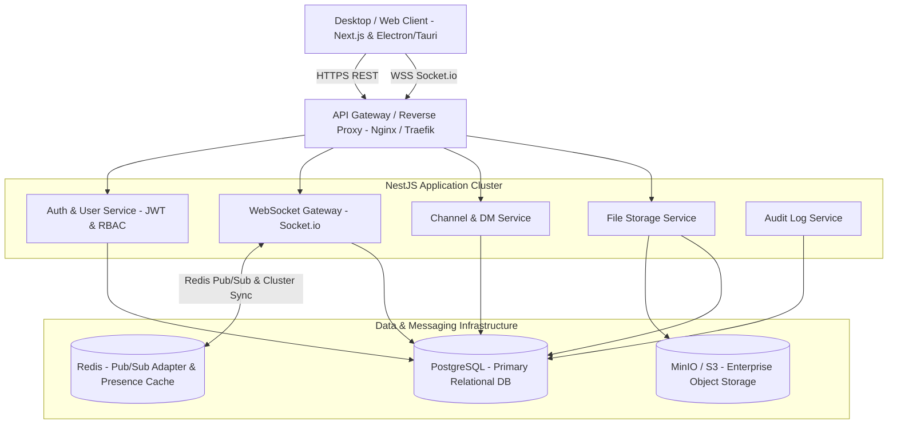

# Enterprise Chat App (Internal Company Chat Platform)

## Overview

A dedicated, on-premise or private-cloud internal communication system designed for corporate environments. It delivers real-time direct messaging, public/private channels organized by department or project, enterprise-grade access control (RBAC), secure file sharing with audit trails, and a native desktop experience (Electron/Tauri) alongside a web app.

### Scope Mode: HOLD SCOPE
- **Core Focus**: High reliability real-time communication, clean organizational structure (teams/channels/DMs), strict RBAC permissions, robust file sharing, and dedicated desktop application.
- **Out of Scope (Deferred to Future Scope Expansion)**: WebRTC voice/video meetings, end-to-end encrypted secret chats (E2EE), LDAP/Active Directory live sync (mocked/prepared via clean auth interfaces), external bot marketplace.

## Technical Architecture Overview

## Phases

| Phase | Name | Priority | Effort | Status |
|-------|------|----------|--------|--------|
| 1 | [Architecture & Infrastructure Setup](./phase-01-architecture-infrastructure-setup.md) | P1 | 3d | Completed |
| 2 | [Realtime Messaging & Channels](./phase-02-realtime-messaging-channels.md) | P1 | 4d | Completed |
| 3 | [File Storage & Enterprise RBAC](./phase-03-file-storage-enterprise-rbac.md) | P2 | 3d | Completed |
| 4 | [Web & Desktop Client](./phase-04-web-desktop-client.md) | P1 | 4d | Completed |
| 5 | [Security Hardening & Deployment](./phase-05-security-hardening-deployment.md) | P2 | 2d | Completed |

## Tech Stack Summary

- **Backend**: NestJS (TypeScript), Prisma ORM, Socket.io with `@socket.io/redis-adapter`
- **Database & Cache**: PostgreSQL 16+, Redis 7+
- **Object Storage**: MinIO (S3-compatible, self-hosted for enterprise data ownership)
- **Frontend**: Next.js 15+ (App Router), React 19, Tailwind CSS, shadcn/ui, Zustand/TanStack Query
- **Desktop Wrapper**: Electron / Tauri packaging with native OS notifications, system tray, and auto-update
- **DevOps**: Docker Compose for local development, multi-stage Dockerfiles, GitHub Actions CI/CD
