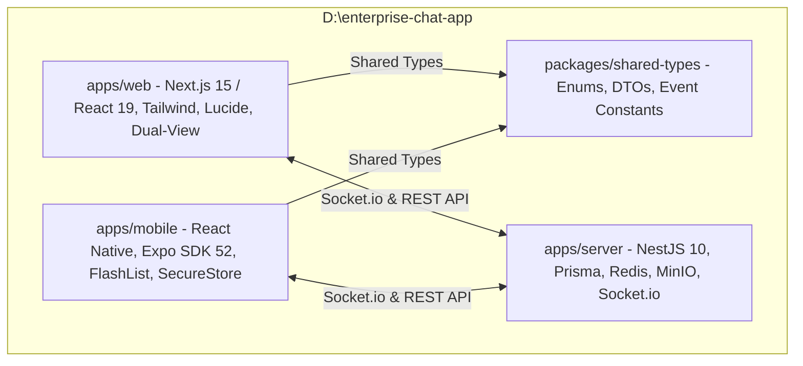

# Migration: React Web and React Native App (iOS & Android)

## Overview

Di chuyển toàn bộ chức năng của ứng dụng chat từ nền tảng **Vue 3 (MIC Chat)** sang hệ sinh thái **React hiện đại (Web)** và **React Native / Expo (iOS & Android)**. Dự án được đặt độc lập tại thư mục gốc `D:\enterprise-chat-app` (tương tự như `D:\IDE`), dỡ bỏ hoàn toàn mọi tiền tố, định danh và tài nguyên liên quan đến thương hiệu **Mic**.

---

## Architecture & Monorepo Structure

---

## Phases

| Phase | Name | Priority | Effort | Status |
|-------|------|----------|--------|--------|
| 1 | [Shared Types and Debranding](./phase-01-shared-types-and-debranding.md) | P1 | 1d | Completed |
| 2 | [React Web Migration](./phase-02-react-web-migration.md) | P1 | 3d | Completed |
| 3 | [React Native Mobile Migration](./phase-03-react-native-mobile-migration.md) | P1 | 3d | Completed |
| 4 | [Integration and Verification](./phase-04-integration-and-verification.md) | P1 | 1d | Completed |

---

## Success Criteria

- [ ] Dự án được đặt hoàn toàn tại `D:\enterprise-chat-app`, không còn phụ thuộc thư mục `d:\mic-fe-micro`.
- [ ] Không còn bất kỳ từ khóa, biến hoặc file tài nguyên nào mang tiền tố `Mic` / `mic-` trong codebase mới.
- [ ] Ứng dụng Web bằng React 19 / Next.js 15 tái tạo đầy đủ 17 tính năng: tin nhắn text/ảnh/file/voice, bình chọn khảo sát, ghim, đánh dấu sao, tóm tắt AI, thoại/video call, clipboard paste, @mention, 5 theme, và chế độ Floating Widget.
- [ ] Ứng dụng Mobile React Native (Expo) chạy mượt mà trên cả iOS Simulator và Android Emulator với bàn phím responsive, haptics, FlashList, và cuộc gọi.
- [ ] `pnpm build` và typecheck thành công 100% trên toàn bộ các workspace trong monorepo.
