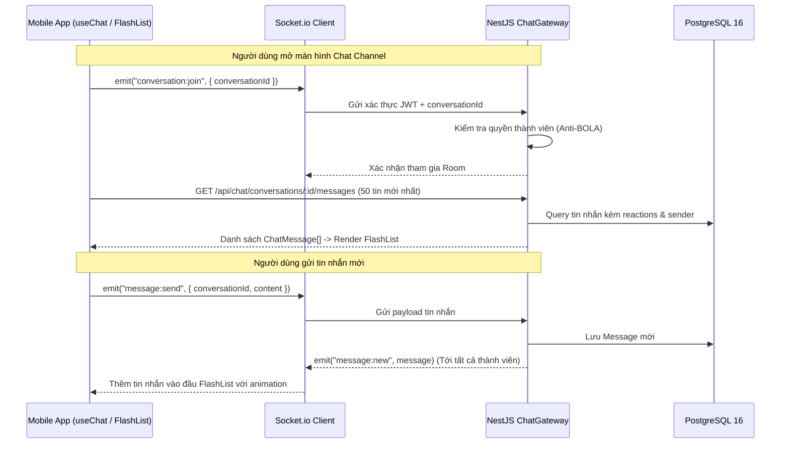

# Phase 3: Realtime Chat, Channels & DMs

## Overview
Phát triển trải nghiệm nhắn tin thời gian thực hoàn chỉnh trên thiết bị di động. Kết nối Socket.io client có cơ chế tự động tái kết nối theo trạng thái ứng dụng (`AppState` Active/Background). Sử dụng `@shopify/flash-list` để tối ưu hóa hiệu năng cuộn danh sách hàng nghìn tin nhắn ở tốc độ 60/120fps. Xây dựng màn hình danh sách Kênh/DM và màn hình chat chi tiết hỗ trợ biểu tượng cảm xúc, trạng thái đang gõ và đánh dấu đã đọc.

---

## Requirements

### Functional
- Danh sách Kênh (Channels): Phân nhóm Kênh toàn công ty (`COMPANY`) và Kênh phòng ban (`DEPARTMENT`). Hiển thị huy hiệu số tin chưa đọc.
- Danh sách Tin nhắn trực tiếp (DMs): Hiển thị đồng nghiệp kèm chấm trạng thái Online / Away / Offline trực quan theo thời gian thực.
- Màn hình Trò chuyện Chi tiết:
  - Cuộn phân trang tin nhắn cũ (Infinite scrolling kéo lên để tải thêm tin nhắn trước đó).
  - Khung nhập tin nhắn tích hợp bàn phím mượt mà không bị che khuất (`react-native-keyboard-controller`).
  - Hiển thị bong bóng tin nhắn (Message Bubbles) phân biệt người gửi / người nhận, hỗ trợ tin nhắn đã chỉnh sửa (`isEdited`) và đã thu hồi (`isDeleted`).
  - Thả cảm xúc nhanh (Reaction Picker: 👍, ❤️, 🚀, 🎉) và xem danh sách người đã thả cảm xúc.
  - Hiển thị người đang nhập tin nhắn (Typing indicator: "Nguyễn Văn A đang gõ...").
- Tự động gửi sự kiện `message:read` khi mở xem cuộc hội thoại.

### Non-functional
- Tốc độ khung hình (Frame Rate): Duy trì ổn định 60fps khi cuộn tin nhắn trên thiết bị tầm trung.
- Trễ nhận tin nhắn thời gian thực < 100ms khi kết nối Wifi/4G.
- Quản lý tài nguyên: Tự động ngắt socket hoặc chuyển sang chế độ tiết kiệm khi app chuyển xuống Background quá 60 giây.

---

## Architecture & Realtime Synchronization

---

## Related Code Files

- **Create:**
  - `apps/mobile/src/services/socket-service.ts`
  - `apps/mobile/src/stores/chat-store.ts`
  - `apps/mobile/src/components/chat/message-list.tsx`
  - `apps/mobile/src/components/chat/message-item.tsx`
  - `apps/mobile/src/components/chat/chat-input-bar.tsx`
  - `apps/mobile/src/components/chat/reaction-picker.tsx`
  - `apps/mobile/src/components/chat/typing-bubble.tsx`
  - `apps/mobile/app/chat/[id].tsx`
  - `apps/mobile/app/(tabs)/channels.tsx`
  - `apps/mobile/app/(tabs)/direct.tsx`
- **Modify:**
  - `apps/mobile/app/(tabs)/_layout.tsx`

---

## Implementation Steps

1. **Cài đặt thư viện giao diện hiệu năng cao**:
   - Cài đặt `@shopify/flash-list`, `react-native-keyboard-controller`, `socket.io-client`.
2. **Xây dựng `socket-service.ts`**:
   - Quản lý instance socket duy nhất; tự động truyền `auth: { token: accessToken }`.
   - Lắng nghe sự kiện `AppState`: Khi app `active`, kiểm tra và kết nối lại socket nếu bị rớt; khi app `background`, gửi trạng thái `AWAY`.
3. **Quản lý trạng thái Chat `chat-store.ts` (Zustand)**:
   - Quản lý danh sách hội thoại, tin nhắn theo từng `conversationId`, danh sách typing và trạng thái kết nối.
4. **Màn hình Kênh (`channels.tsx`) & Tin nhắn trực tiếp (`direct.tsx`)**:
   - Fetch dữ liệu từ `GET /api/channels/my-conversations` và `GET /api/users`.
   - Hiển thị danh sách kênh kèm biểu tượng `#` (Company) và `🔒` (Department/Private).
   - Hiển thị đồng nghiệp kèm avatar và chấm presence xanh/vàng/xám.
5. **Màn hình Chat Chi tiết (`app/chat/[id].tsx`)**:
   - Sử dụng `@shopify/flash-list` với thuộc tính `inverted` để tin nhắn mới nhất xuất hiện ở đáy và cuộn mượt mà.
   - Tích hợp `KeyboardProvider` và `KeyboardAvoidingView` để thanh nhập tin nhắn di chuyển tự nhiên theo bàn phím iOS/Android.
   - Thêm nút Reaction Bar khi bấm giữ tin nhắn (Long-press haptic feedback).
   - Debounce sự kiện `typing:start` và `typing:stop` (500ms).

---

## Success Criteria

- [ ] Tin nhắn gửi đi xuất hiện tức thì trên màn hình mobile và đồng bộ ngay sang Web/Desktop.
- [ ] Cuộn danh sách 500+ tin nhắn không có hiện tượng drop frame hoặc lag giao diện.
- [ ] Bàn phím bật lên không che khuất tin nhắn cuối cùng trên cả iPhone (có Home Bar) và Android.
- [ ] Bấm giữ tin nhắn hiển thị menu thả biểu tượng cảm xúc và cập nhật số lượng realtime.
- [ ] Đổi mạng từ Wifi sang 4G: Socket tự động kết nối lại trong vòng 3 giây.

---

## Risk Assessment

| Rủi ro | Tác động | Giải pháp giảm thiểu |
|---|---|---|
| Bàn phím Android đẩy lệch layout hoặc che mất input | Cao | Sử dụng `react-native-keyboard-controller` thay vì `KeyboardAvoidingView` mặc định của React Native. |
| Memory leak do render quá nhiều ảnh/avatar trong FlatList | Cao | Sử dụng `@shopify/flash-list` có cơ chế tái sử dụng view và dùng `expo-image` để cache ảnh đại diện. |
