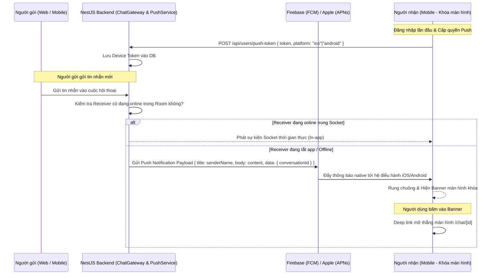

# Phase 5: Push Notifications & Offline Sync

## Overview
Xây dựng hệ thống Thông báo đẩy từ xa (Remote Push Notifications) và cơ chế lưu trữ đệm ngoại tuyến (Offline Sync). Cho phép ứng dụng nhận thông báo tức thời về tin nhắn mới, cuộc gọi hoặc lượt nhắc tên (@mention) ngay cả khi đã tắt app hoặc khóa màn hình thông qua Apple Push Notification service (APNs) và Firebase Cloud Messaging (FCM). Đồng thời lưu trữ đệm danh sách tin nhắn cục bộ bằng `react-native-mmkv` để mở app xem lại tin nhắn cũ ngay lập tức mà không cần mạng.

---

## Requirements

### Functional
- Cấp quyền & Đăng ký Push Token:
  - Yêu cầu người dùng cấp quyền nhận thông báo khi lần đầu đăng nhập thành công.
  - Lấy Expo Push Token / FCM Device Token và gửi lên backend qua endpoint `POST /api/users/push-token`.
- Xử lý tương tác thông báo:
  - Khi có tin nhắn mới gửi đến mà người dùng đang không ở trong màn hình chat đó (hoặc app đang tắt): Thiết bị phát chuông, rung và hiện banner thông báo kèm tên người gửi và nội dung tin nhắn.
  - Bấm vào thông báo: Tự động điều hướng chính xác vào cuộc hội thoại tương ứng (`/chat/[id]`).
  - Cập nhật số lượng tin chưa đọc trên biểu tượng ứng dụng ngoài màn hình chính (App Icon Badge Count).
- Trải nghiệm Ngoại tuyến (Offline-First Read):
  - Lưu danh sách kênh và 50 tin nhắn gần nhất của mỗi hội thoại vào bộ lưu trữ tốc độ cao `react-native-mmkv`.
  - Mở app khi mất mạng: Hiển thị ngay lập tức dữ liệu đã lưu kèm thanh trạng thái màu cam: *"Đang mất kết nối mạng. Đang thử lại..."*.
  - Hàng đợi tin nhắn gửi đi (Outbox Queue): Nếu người dùng ấn gửi tin khi offline, tin nhắn được đánh dấu biểu tượng đồng hồ *"Đang gửi"*. Ngay khi có mạng trở lại qua `@react-native-community/netinfo`, hệ thống tự động đẩy tin nhắn lên server mà không cần ấn lại.

### Non-functional
- Độ trễ nhận Push Notification từ lúc người gửi ấn Send đến khi máy người nhận rung < 2 giây.
- Tốc độ đọc tin nhắn từ cache MMKV khi mở app < 50ms.
- Bảo mật quyền riêng tư: Tùy chọn ẩn nội dung tin nhắn nhạy cảm trên màn hình khóa trong Cài đặt.

---

## Architecture & Push Notification Flow



---

## Related Code Files

- **Create:**
  - `apps/mobile/src/services/push-notification-service.ts`
  - `apps/mobile/src/services/offline-storage.ts`
  - `apps/mobile/src/hooks/use-network-status.ts`
  - `apps/mobile/src/components/common/network-banner.tsx`
- **Modify:**
  - `apps/mobile/app/_layout.tsx` (Lắng nghe sự kiện click Push Notification)
  - `apps/mobile/src/stores/chat-store.ts` (Tích hợp MMKV persist cache & Outbox queue)
  - `apps/server/prisma/schema.prisma` (Thêm model `DeviceToken` lưu token người dùng)
  - `apps/server/src/modules/users/users.service.ts` (API đăng ký và xóa Push Token)

---

## Implementation Steps

1. **Cài đặt thư viện Push & Offline Storage**:
   - `npx expo install expo-notifications expo-device @react-native-community/netinfo react-native-mmkv`.
2. **Cập nhật Backend Schema**:
   - Thêm model `DeviceToken`:
     ```prisma
     model DeviceToken {
       id        String   @id @default(uuid())
       userId    String
       token     String   @unique
       platform  String   // ios, android
       createdAt DateTime @default(now())
       user      User     @relation(fields: [userId], references: [id], onDelete: Cascade)
     }
     ```
   - Tạo endpoint `POST /api/users/push-token` và tích hợp Firebase Admin SDK / Expo Server SDK trong `ChatGateway` để tự động push khi user offline.
3. **Xây dựng `push-notification-service.ts`**:
   - Hàm `registerForPushNotificationsAsync()`: Xin quyền `Notifications.requestPermissionsAsync()` và lấy token.
   - Cấu hình Notification Handler: Xác định hiển thị âm thanh, badge và alert.
4. **Xử lý Điều hướng khi Bấm Thông báo**:
   - Sử dụng `Notifications.addNotificationResponseReceivedListener`:
     Trích xuất `response.notification.request.content.data.conversationId` và gọi `router.push('/chat/' + conversationId)`.
5. **Cấu hình Bộ Nhớ Đệm Offline MMKV**:
   - Sử dụng MMKV lưu trữ trạng thái `chatStore`: tin nhắn và danh sách kênh được tự động đồng bộ xuống bộ nhớ flash của máy.
6. **Thanh Trạng Thái Mạng & Outbox Queue**:
   - Hook `useNetworkStatus`: Giám sát mạng qua `NetInfo.addEventListener`.
   - Khi có kết nối lại, duyệt qua các tin nhắn có cờ `status: 'SENDING'` trong `chatStore` và gửi lại qua socket.

---

## Success Criteria

- [ ] Thiết bị nhận được thông báo đẩy native khi app đang bị tắt hoàn toàn (Killed state).
- [ ] Bấm vào thông báo trên màn hình khóa mở thẳng vào kênh chat của tin nhắn đó.
- [ ] Bật chế độ máy bay (Airplane mode) rồi mở app: Vẫn đọc được toàn bộ tin nhắn đã tải trước đó một cách mượt mà.
- [ ] Gửi tin nhắn lúc mất mạng -> bật lại mạng: Tin nhắn tự động được gửi đi thành công mà không cần người dùng thao tác lại.
- [ ] Đăng xuất: Device Token bị gỡ bỏ khỏi backend, không còn nhận thông báo của tài khoản cũ.

---

## Risk Assessment

| Rủi ro | Tác động | Giải pháp giảm thiểu |
|---|---|---|
| Pin của hệ điều hành Android tự động kill tiến trình nhận Push | Trung bình | Hướng dẫn người dùng bật quyền "Tự khởi chạy" và không hạn chế pin cho ứng dụng trong mục Cài đặt. |
| Người dùng từ chối cấp quyền thông báo | Thấp | Vẫn cho phép sử dụng bình thường và hiển thị một banner nhắc nhở nhẹ nhàng trong tab Cài đặt. |
