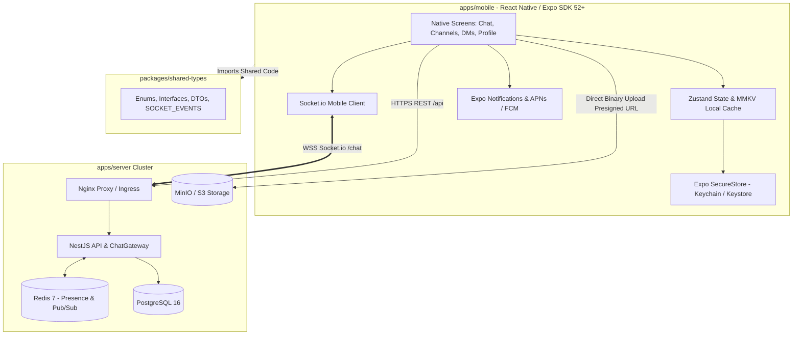

# React Native Mobile App (iOS & Android)

## Overview

Ứng dụng di động nội bộ doanh nghiệp chuyên dụng dành cho điện thoại thông minh (iOS và Android), được phát triển độc lập trong thư mục `apps/mobile` thuộc Monorepo `enterprise-chat-app`. Ứng dụng tái sử dụng hoàn toàn hạ tầng Backend NestJS hiện tại, các chuẩn giao tiếp WebSocket và package chung `@enterprise-chat/shared-types`.

Dự án cung cấp trải nghiệm nhắn tin thời gian thực mượt mà (60/120fps), thông báo đẩy (Push Notification) khi ứng dụng chạy nền hoặc tắt màn hình, bảo mật sinh trắc học (FaceID / Fingerprint) và khả năng tải lên tệp tin/hình ảnh an toàn.

---

## Technical Stack & Architecture

---

## Phases

| Phase | Name | Priority | Effort | Status |
|-------|------|----------|--------|--------|
| 1 | [Architecture & Expo Foundation](./phase-01-architecture-and-expo-setup.md) | P1 | 2d | Completed |
| 2 | [Authentication & Secure Storage](./phase-02-authentication-and-secure-storage.md) | P1 | 2d | Pending |
| 3 | [Realtime Chat, Channels & DMs](./phase-03-realtime-chat-channels-and-dms.md) | P1 | 3d | Pending |
| 4 | [Media Handling & Attachments](./phase-04-media-handling-and-attachments.md) | P2 | 2d | Pending |
| 5 | [Push Notifications & Offline Sync](./phase-05-push-notifications-and-offline-sync.md) | P1 | 3d | Pending |

---

## Success Criteria

- [ ] Hoàn thành tích hợp `apps/mobile` trong `pnpm-workspace.yaml`, build sạch không xung đột dependency.
- [ ] Xác thực JWT bảo mật: Access Token lưu RAM, Refresh Token mã hóa trong phần cứng (`expo-secure-store`), hỗ trợ FaceID/TouchID.
- [ ] Nhận và gửi tin nhắn thời gian thực qua WebSocket với độ trễ < 100ms trên mạng 4G/Wifi.
- [ ] Danh sách tin nhắn cuộn mượt mà với 10,000+ tin nhắn sử dụng `@shopify/flash-list`.
- [ ] Tải lên ảnh/tệp đính kèm trực tiếp lên S3 qua Presigned URL có thanh tiến trình (progress bar).
- [ ] Nhận thông báo đẩy (Push Notifications) khi tắt app hoặc màn hình khóa qua Firebase / APNs.
